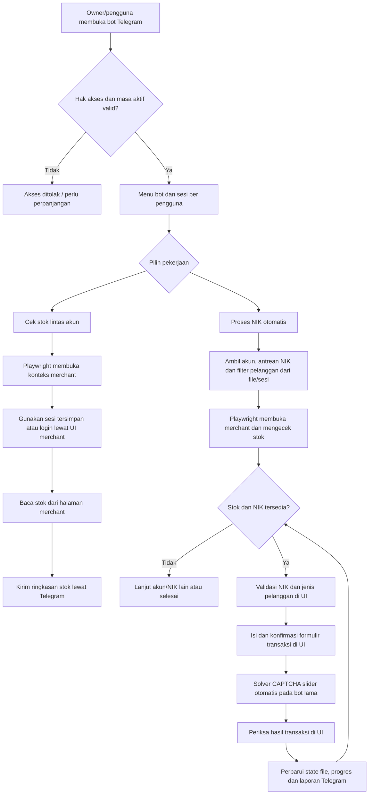
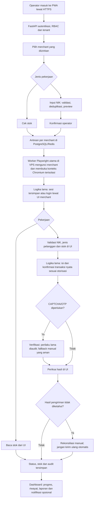

# Peta alur Mapauto: bot utama → webapp

Peta ini berasal dari audit statis kode bot utama dan kode webapp pada branch `feature/mapauto-vps`. Ini bukan bukti transaksi live berhasil. `semiauto/` telah dihapus atas permintaan pemilik dan tidak menjadi sumber alur target.

## 1. Bot Telegram sebelumnya (terlihat di kode)

Sumber utama: `BOT1_CAPTCHA.py` mengelola interaksi Telegram, akses/masa aktif dan pemanggilan pekerjaan; `modules/auto_transaction.py` memilih akun/NIK dan mengulang proses; `modules/pertamina.py` menangani sesi/login, pemeriksaan NIK, formulir, CAPTCHA dan hasil; `modules/stock.py` membaca stok; `modules/captcha.py` adalah solver slider otomatis. Bot lama menyimpan sebagian akun, cookie, antrean dan state pada file. Ini temuan keamanan, bukan pola penyimpanan yang akan dipertahankan.

## 2. Webapp yang dituju: ganti pintu masuk, pertahankan proses utama

Maksud pemilik adalah mengganti antarmuka Telegram dengan Web App. Urutan bisnis pada worker Playwright lama tetap menjadi acuan: sesi/login merchant, cek stok, pilih NIK dan filter pelanggan, proses melalui UI merchant, pemeriksaan hasil, lalu progres/laporan. Pemindahan ke VPS memerlukan pemisahan panggilan Telegram dan state file dari fungsi worker, serta pengamanan sesi dan data; itu bukan penggantian proses merchant dengan API atau simulasi sebagai hasil akhir.

Browser, database, Redis dan worker berjalan di VPS; pengguna hanya memakai browser PWA. Satu merchant tidak berbagi browser context/cookie dengan merchant lain. Admin mengelola akses merchant, pengguna, masa aktif, worker dan pengaturan. Telegram menjadi notifikasi opsional, bukan pengendali pekerjaan. Perilaku CAPTCHA lama memang otomatis di kode, tetapi pengguna sebelumnya juga melarang bypass CAPTCHA dan meminta checkpoint manual. Migrasi bagian ini perlu dibatasi oleh izin penggunaan layanan dan pengujian terotorisasi; OTP tidak boleh diotomatisasi atau dilewati.

## 3. Status implementasi saat ini

| Tahap | Status |
| --- | --- |
| Login PWA, RBAC, tenant dan izin merchant | Ada dan diuji secara lokal |
| Batch NIK sintetis, validasi, preview, antrean, pause/resume/cancel | Ada dalam Demo Mode |
| Worker Chromium terisolasi, job lock, checkpoint, rekonsiliasi | Ada dan diuji dengan merchant mock |
| Pembacaan stok serta transaksi melalui UI MyPertamina live | **Belum terhubung**; worker saat ini hanya memakai merchant mock |
| CAPTCHA slider otomatis | **Ada di bot lama** (`modules/captcha.py`), **belum ada di worker web** |
| OTP/CAPTCHA pada webapp | Worker demo saat ini memakai checkpoint manual; kode lama memiliki solver CAPTCHA otomatis, tetapi belum dipindahkan atau dinyatakan aman untuk layanan live |
| Akun dan NIK asli | Belum dipakai atau diuji di webapp; batch live ditolak |

Migrasi live perlu memvalidasi ulang urutan halaman dan hasil terhadap akun merchant yang benar-benar diotorisasi. Jangan menyalin cookie, PIN, atau NIK lama dari repository. Pengujian otomatis tetap menggunakan merchant mock dan data sintetis; transaksi yang statusnya tidak pasti harus direkonsiliasi sebelum pekerjaan lain pada merchant itu berjalan.
